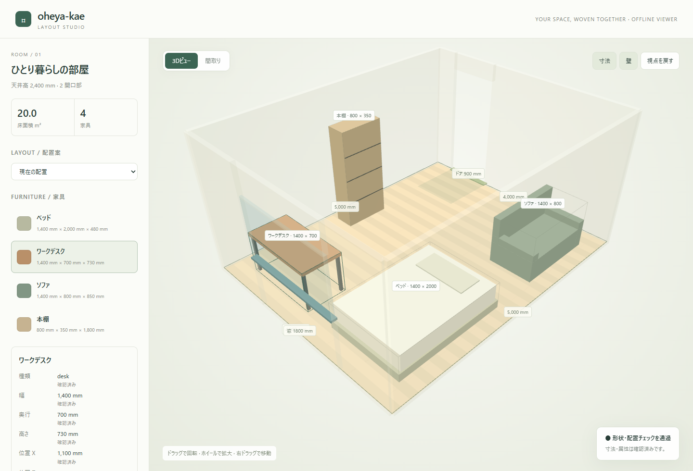

# oheya-kae

oheya-kaeは、部屋と家具のレイアウトを作成・検証し、インタラクティブな3Dビューアーで確認できるCLIツールです。間取り画像や写真の解析は呼び出し元のAIが担当し、本ツールは解析JSONの取り込み・編集・検証・表示を行います。実測した寸法から作成することもできます。



## ワークフロー

| ステップ | できること |
| --- | --- |
| **つくる** | 間取り画像・室内写真の解析結果を取り込むか、寸法と輪郭を入力して1部屋を作成します。 |
| **整える** | 家具を追加・移動・回転し、ドアや窓の位置、画像から推定した寸法を補正します。 |
| **確かめる** | 家具同士の重なり、部屋からのはみ出し、ドア前の障害物、天井高超過を検証します。 |
| **比べる** | 最大3つの配置案を生成し、HTML上で同じ視点のまま切り替えて比較します。 |
| **共有する** | 元画像と部屋データを含むHTMLを書き出して共有し、編集用のJSONを保存します。 |

画像から判断できない寸法は不明のまま保持し、確認が必要な項目をJSONとビューアーに表示します。実寸を入力してから配置を再検証できます。

## はじめる

npmへの公開後は、次のコマンドでインストールできます（Node.js 22以上）。

```sh
npm install --global oheya-kae
oheya-kae --help
```

インストールしたCLIでは、以下の例の `node bin/oheya-kae.js` を `oheya-kae` に置き換えて使います。

必要なものは**Node.js 22以上**と**npm**です。対応ブラウザは**Google Chromeのみ**です。WebGLを有効にしてご利用ください。以下のコマンドはリポジトリのルートで実行してください。

```sh
npm ci
npm run build
npm run demo
```

生成された`output/demo.html`をGoogle Chromeで直接開くと、4つの家具と3つの配置案を試せます。`npm run demo`を再実行すると、`output/demo.json`と`output/demo.html`を作り直します。

CLIのヘルプは次のコマンドで確認できます。

```sh
node bin/oheya-kae.js --help
node bin/oheya-kae.js room --help
node bin/oheya-kae.js furniture --help
```

`npm run oheya-kae -- ...`でも実行できます。AIがJSONを読み取る用途には、npmのログが混ざらない`node bin/oheya-kae.js ...`が適しています。`npm link`でローカルに登録すれば、`oheya-kae`コマンドも使えます。

## AIと使う

CLIを実行できるAIツールでこのフォルダを開き、画像や実測値を渡して、たとえば次のように依頼します。

> oheya-kaeのREADMEとCLIガイドを読み、schemaコマンドの形式に合わせて、添付した間取り画像をあなた自身で解析してください。南側の壁は4000mmです。解析結果をJSONに保存して、元画像とともにroom importで取り込んでください。画像から確定できない寸法は不明として残し、確認が必要な項目を教えてください。配置を検証して、`output/my-room.html`に書き出してください。

配置を検討するときは、次のように依頼できます。

> デスクを幅1200mm・奥行600mm・高さ720mmで追加してください。仕事優先の配置案を3つ作り、検証結果と注意点を説明して、比較用HTMLを書き出してください。

### 利用側のAIで画像を解析する

`schema`コマンドで解析用プロンプトとJSON Schemaを取得し、呼び出し元のAIに画像・既知の寸法とともに渡して、解析JSONを作成してもらいます。本ツールは画像解析を実行せず、外部APIへの送信も行いません。APIキーやモデル設定は不要です。呼び出し元AIの通信や料金は、そのツールの設定によります。

```sh
node bin/oheya-kae.js schema --kind room
node bin/oheya-kae.js schema --kind furniture
```

呼び出し元AIが`room-analysis.json`と`furniture-analysis.json`を作成した後、元画像とともに取り込みます。既知の寸法や補足説明は、画像を解析するAIへ直接伝えてください。

```sh
node bin/oheya-kae.js room import --image floorplan.jpg --image room.jpg --analysis room-analysis.json
node bin/oheya-kae.js furniture import --image desk.jpg --analysis furniture-analysis.json
```

解析JSONの例は、このページの[部屋の解析JSON](#部屋の解析json)と[家具の解析JSON](#家具の解析json)を参照してください。各例を記載のファイル名で保存し、数値や根拠を実画像に合わせて変更してから取り込みます。画像だけの取り込みも可能ですが、その場合は自動解析せず、寸法や輪郭を不明として保存します。

## 寸法から作る

実測した寸法を直接入力して作成できます。次の例は、新しいプロジェクトに4m × 5mの部屋とデスクを作り、検証してHTMLに書き出します。

```sh
node bin/oheya-kae.js room create --name "仕事部屋" --width 4000 --depth 5000 --height 2400
node bin/oheya-kae.js furniture add --id desk-1 --name "机" --kind desk --color "#b99069" --width 1200 --depth 600 --height 720 --x 1800 --z 800 --rotation 0
node bin/oheya-kae.js layout validate --json
node bin/oheya-kae.js export --format html --output output/room.html
```

長さの単位はすべて**mm**です。家具の`x,z`は底面の中心座標、`rotation`はY軸まわりの回転角です。標準の保存先は`oheya-kae.json`で、各コマンドの先頭に`--project output/my-room.json`を付けると別のプロジェクトを使えます。

既存の部屋を置き換えるには`room create/import`に`--replace`が必要です。その際も家具は保持されます。凹形の輪郭、ドア・窓、縮尺補正などの操作は[CLIガイド](./docs/cli.md)を参照してください。

### 配置案を比べる

```sh
node bin/oheya-kae.js layout propose --preference "仕事優先" --count 3
node bin/oheya-kae.js export --output output/comparison.html
```

HTMLの「配置案」から切り替えて比較できます。採用する案は、CLIが返すIDを`layout apply --id`に指定します。配置案はグリッド探索で生成し、「仕事」「work」などの条件ではデスクを窓の近くに優先配置します。詳しい希望条件は、利用側AIに家具の寸法・位置・回転へ変換してもらえます。

## ビューアーで確認する

| 操作 | 内容 |
| --- | --- |
| ドラッグ・ホイール・右ドラッグ | 視点の回転・拡大縮小・移動 |
| **3Dビュー / 間取り** | 立体表示と真上からの表示を切り替え |
| **寸法 / 壁 / 視点を戻す** | 寸法と壁の表示切り替え、視点のリセット |
| 家具を選択 | 名前・寸法・位置と、その値の確認状態を表示 |
| **配置案** | 現在の配置と提案された配置を比較 |
| **元画像 / 補正・確認** | 取り込んだ画像と、確認が必要な項目を表示 |

HTMLにはThree.js・部屋データ・元画像を埋め込みます。CLIで編集した後は、HTMLを再出力して開き直してください。共有相手はoheya-kaeをインストールする必要がありません。

## 現在の対応範囲

- 1部屋の矩形・凹多角形の輪郭と、ドア・窓に対応します。
- 家具は8種類（`box`、`desk`、`table`、`chair`、`sofa`、`bed`、`shelf`、`cabinet`）を、寸法・色に基づく簡単な立体で表示します。
- 配置検証は家具の底面矩形と天井高を使います。積み重ねや立体の隙間、扉の厳密な開閉軌跡、通路全体の連結性は扱いません。
- 配置案は最大3案の簡易探索で、任意の自然言語条件の理解や最適解を保証するものではありません。
- HTMLでの家具編集・保存、商品検索、精細な3Dモデルは今後の検討項目です。

## JSON入力例

以下は`--analysis`や`--data`に渡すファイルの例です。リポジトリには同名のファイルを同梱していないため、必要な例をコピーしてUTF-8で保存してください。相対パスはコマンドを実行するディレクトリを基準にします。

### 部屋の解析JSON

`room-analysis.json`として保存します。図面に4,000 × 5,000mmの寸法が記載されている場合の例です。実画像に合わせて値・根拠・未確認項目を変更してください。縮尺が分からない場合は`outline`を`null`にします。

```json
{
  "room": {
    "name": "部屋",
    "outline": [[0, 0], [4000, 0], [4000, 5000], [0, 5000]],
    "height": null,
    "evidence": {
      "outline": { "status": "image", "note": "図面に4000 × 5000mmの記載あり。" }
    },
    "uncertainties": ["天井高とドア・窓の位置は未確認です。"]
  },
  "furniture": []
}
```

### 家具の解析JSON

`furniture-analysis.json`として保存します。幅・奥行が画像に記載され、高さと配置が不明なデスクの例です。

```json
{
  "furniture": {
    "name": "デスク",
    "kind": "desk",
    "width": 1200,
    "depth": 600,
    "height": null,
    "evidence": {
      "width": { "status": "image", "note": "画像に幅1200mmの記載あり。" },
      "depth": { "status": "image", "note": "画像に奥行600mmの記載あり。" }
    },
    "uncertainties": ["高さ・色・部屋内の位置と回転は未確認です。"]
  }
}
```

これらはオフライン取り込み用の部分的なJSONです。AIへの解析依頼に使う完全なJSON Schemaは、`schema --kind room`または`schema --kind furniture`で取得してください。省略した属性の扱いと根拠の管理は[CLIガイド](./docs/cli.md)を参照してください。

### 未確認項目を解消する更新JSON

`uncertainties`に記載した指摘をすべて確認・解消した後、次の内容を`clear-uncertainties.json`として保存します。

```json
{
  "uncertainties": []
}
```

```sh
node bin/oheya-kae.js furniture update --id desk-1 --data clear-uncertainties.json
```

`desk-1`は対象の家具IDに置き換えてください。この更新は指摘の一覧を空にする操作で、寸法を補完したり、各属性の`evidence`を確認済みにしたりするものではありません。実寸の入力や`--confirm`は別途行います。

## ドキュメント

- [CLIガイド](./docs/cli.md)：画像取り込み、寸法補正、根拠管理、JSON出力、終了コード、配置検証の詳細
- [部屋の解析JSON例](#部屋の解析json)
- [家具の解析JSON例](#家具の解析json)
- [未確認項目を解消する更新JSON例](#未確認項目を解消する更新json)

## 開発・動作確認

```sh
npm run lint
npm test
npm run demo
npm run test:browser
npm run test:package
```

`npm test`はビューアーをビルドし、形状判定、根拠管理、CLIの保存・読み込み、HTML生成、画像と解析JSONのローカル取り込みを検証します。ブラウザ確認は、すべてのOSでGoogle Chromeのみを使用します。事前にGoogle Chromeをインストールしてください（開発環境では`npx playwright install chrome`でも準備できます）。CIもGoogle Chromeで検証します。

`viewer/`を変更した場合は`npm run build`で再ビルドし、HTMLを再出力してください。

ビューアーのCSSは `viewer/viewer.css` で管理します。HTML出力時にCSSを埋め込むため、配布するファイルは引き続きHTMLひとつです。
